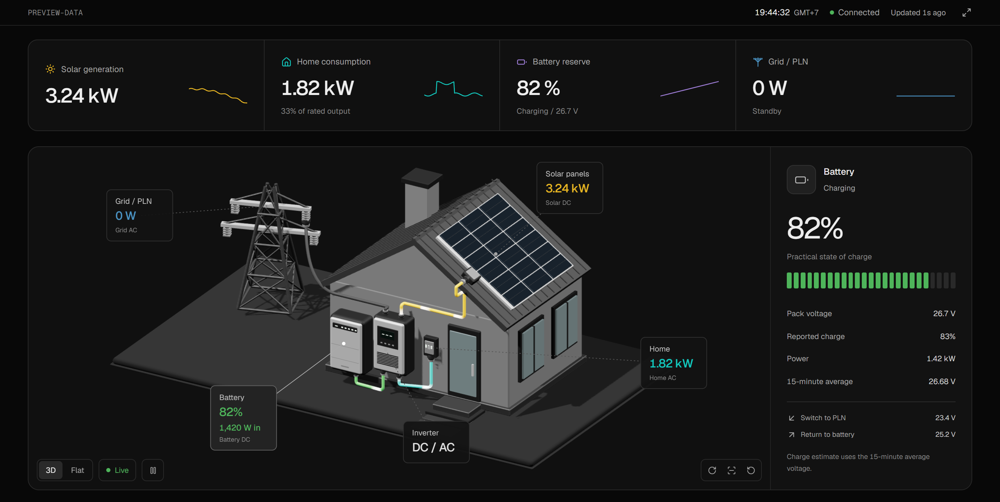

# Solar Monitoring

Self-hosted monitoring and control for a home solar, battery and grid system on a PowMr inverter. Live energy flow, history, daily totals and guarded inverter settings share one dashboard.

[Rust backend checks](https://github.com/faqihxdev/solar-monitoring/actions/workflows/rust-backend.yml) · [Backend](app/backend/README.md) · [Production safety](docs/production-safety.md)



The screenshot uses synthetic telemetry. The deployed instance is private.

## Architecture

A React 18, Vite 6, Tailwind CSS 4, Three.js, Recharts and TanStack Query frontend is served by Nginx on a Hetzner VPS behind Cloudflare Access. Nginx proxies `/api` to a Rust Axum API on a loopback port. A separate Rust poller reads DESSMonitor telemetry into SQLite. Inverter reads and writes also go through DESSMonitor, which reaches the inverter through its datalogger.


The Rust backend in [`app/backend`](app/backend/README.md) has run in production since September 30, 2026. It keeps the original API and SQLite schema. The TypeScript backend remains for local development, compatibility fixtures and rollback.

## Engineering highlights

| Capability | Implementation |
| --- | --- |
| Telemetry polling | The poller sends signed DESSMonitor requests every 5 seconds, retries empty responses after 750 ms and commits multi-page battery voltage refreshes in one transaction. |
| Durable storage | SQLite runs in WAL mode with `synchronous=FULL`. Unchanged readings skip the write, and the successful-poll heartbeat is stored at most once a minute. Telemetry and control history use separate databases. |
| Guarded inverter writes | Each write checks catalog limits, reads the current value, skips no-op changes, sends the new value, reads it back and records every step in an audit log. The dashboard asks for confirmation, and canceling sends nothing. |
| Battery automation | A check every 5 minutes adjusts the A6/A7 battery and grid switching band to reach a target charge by a set time. Daily write budgets and cooldowns limit it, and disabling it restores the fallback band. |
| Practical charge | A 24 V voltage curve applied to the 15-minute average pack voltage, shown beside the inverter's reported charge. |

## Run locally

Use Node.js 22 or newer, as specified in `.nvmrc`, and pnpm.

```bash
cp .env.example .env
```

Fill in the DESSMonitor credentials and device identifiers in `.env`, then start the app:

```bash
cd app
pnpm install --frozen-lockfile
pnpm dev
```

Open `http://127.0.0.1:43872`. This starts the UI, API and poller. The API listens on `127.0.0.1:43871`; databases live under `data/` by default.

For UI work against an existing API, set `DESS_DEV_API_TARGET` and run `pnpm dev:ui`. The `.env.example` file also documents the SSH tunnel helper used by `pnpm dev:ui:vps`. See the [backend README](app/backend/README.md) to run the Rust API and poller locally.

## Verification

From `app/`:

```bash
pnpm build
pnpm test
pnpm test:frontend
pnpm exec playwright install chromium
pnpm test:ui
pnpm test:backend
```

Browser tests use a local fixture API with synthetic telemetry, and control writes never reach an inverter. CI runs formatting, Clippy, tests and a release build for the Rust backend.

## Deployment and security

- Keep the API bound to localhost and front it with an authenticated reverse proxy.
- For private internet access, use an access layer such as Cloudflare Access.
- Do not expose write or control endpoints directly to the public internet.
- Keep `.env`, databases and local deployment notes out of Git and source uploads.

The deployment and operations scripts target this project's shared VPS. Review their target checks before adapting them to another host. See [production safety](docs/production-safety.md) for readiness checks, backups and recovery procedures.

## Repository layout

- `app/`: frontend, Rust and TypeScript backends, poller, automation and shared logic
- `docs/`: reverse-engineering notes, tuning plans and reference docs
- `scripts/`: deployment automation
- `ops/`: Solar service overrides and database backup units

See the [documentation index](docs/README.md), [interface design](docs/interface-design.md) and [DESSMonitor API notes](docs/dessmonitor-api-endpoints.md).

## License

MIT. See [LICENSE](LICENSE).
