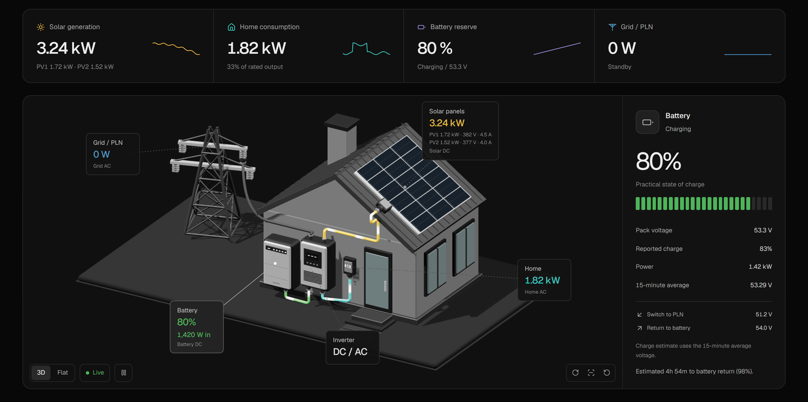

# Solar Monitoring

Self-hosted monitoring for a home solar, battery and grid system. One dashboard shows live energy flow, history, daily totals and inverter settings.

[Rust backend checks](https://github.com/faqihxdev/solar-monitoring/actions/workflows/rust-backend.yml) · [Backend](app/backend/README.md)



The screenshot uses synthetic telemetry. The deployed instance is private.

## Architecture

A React 18, Vite 6, Tailwind CSS 4, Three.js, Recharts and TanStack Query frontend is served by Nginx on a Hetzner VPS behind Cloudflare Access. Nginx proxies `/api` to a Rust Axum API on a loopback port. A separate Rust poller stores inverter telemetry in SQLite.

Each backend build supports one inverter, chosen by a Cargo feature:

- `growatt` (in production since November 6, 2026) reads a Growatt SPF through the Growatt OpenAPI every 60 seconds and backfills up to 89 days of history. Settings are read-only, so the dashboard hides writes and automation.
- `dess` reads and writes a PowMr inverter through DESSMonitor every 5 seconds and runs charge automation.


The older TypeScript backend in `app/server` supports DESS only. It remains for local development and the compatibility fixtures.

## Engineering highlights

| Capability | Implementation |
| --- | --- |
| One inverter per build | An `Inverter` trait and a `/api/config` profile tell the dashboard which settings, automation and battery curve exist. |
| Durable storage | SQLite runs in WAL mode with `synchronous=FULL`. Unchanged readings skip the write, and the poll heartbeat is stored at most once a minute. Telemetry and control history use separate databases. |
| Guarded writes (DESS) | Each write checks catalog limits, reads the current value, skips no-op changes, sends the new value, reads it back and records every step in an audit log. Canceling the confirmation sends nothing. |
| Battery automation (DESS) | Every 5 minutes it adjusts the A6/A7 switching band to reach a target charge by a set time, within daily write budgets and cooldowns. |
| Practical charge | The inverter profile's voltage curve, applied to the 15-minute average pack voltage, shown beside the inverter's reported charge. |

## Run locally

Use Node.js 22 or newer (see `.nvmrc`) and pnpm. Copy `.env.example` to `.env` and fill in the inverter credentials.

```bash
cd app
pnpm install --frozen-lockfile
pnpm dev
```

`pnpm dev` starts the UI on `http://127.0.0.1:43872` with the TypeScript API and poller, so it needs DESS credentials. For a Growatt build, run the Rust backend as the [backend README](app/backend/README.md#local-setup) describes. To work on the UI against production data, use `pnpm dev:ui:vps`, which opens an SSH tunnel to the server's API.

## Verification

From `app/`:

```bash
pnpm build
pnpm test
pnpm test:frontend
pnpm exec playwright install chromium
pnpm test:ui
pnpm test:backend
```

Browser tests use a local fixture API with synthetic telemetry, and control writes never reach an inverter. CI checks formatting, Clippy, tests and a release build for both Rust inverter builds.

## Deployment

In production, Nginx serves `app/dist` and proxies `/api` to the API on a loopback port. The API and poller run as systemd services from a versioned release binary. Deployment scripts for the author's server are not part of this repository.

Keep the API on localhost behind an authenticated proxy such as Cloudflare Access, and keep `.env` and the databases out of Git.

## Repository layout

- `app/`: frontend, Rust and TypeScript backends, and shared logic
- `docs/`: design and reference docs ([index](docs/README.md))

## License

MIT. See [LICENSE](LICENSE).
